# imaging-ai-atlas

How has AI research in medical imaging shifted over the last decade?

> Work in progress — this README will grow into the full data story (findings, limitations, figures)
> as milestones land. The spine below is the plan: one README question per pipeline stage per report
> section.

## Story spine

```mermaid
flowchart LR
    classDef data fill:#e8eef7,stroke:#4a6fa5
    classDef model fill:#eef7e8,stroke:#5a9a4a
    classDef evidence fill:#f7efe8,stroke:#b07a3a
    classDef story fill:#f7e8ee,stroke:#a5457a

    src[arXiv snapshot]
    src --> ingest[ingest]
    ingest --> q["Which papers count? — atlas filter"]:::data
    q -- "category + rule, labeled precision/recall" --> dq["Can we trust the data? — atlas quality"]:::data
    dq -- "dedup, LaTeX leakage, growth base rate" --> rep["What is each paper about? — atlas embed"]:::model
    rep -- "sentence embeddings, Matryoshka ablation" --> th["Which themes exist? — atlas model"]:::model
    th -- "UMAP-5D, HDBSCAN, c-TF-IDF" --> ev["Are the themes real? — atlas evaluate"]:::evidence
    ev -- "NPMI, diversity, seed stability" --> dyn["How did they shift? — atlas dynamics"]:::evidence
    dyn -- "per-year share, bootstrap CIs" --> so["So what? — atlas render"]:::story
```

| Question | CLI / DVC stage | Method | Report section |
|---|---|---|---|
| Which papers count? | `atlas filter` | category scope + documented rule; precision and recall on a labeled sample | §1 Corpus |
| Can we trust the data? | `atlas quality` | dedup/versions, short/missing abstracts, LaTeX leakage, date-field choice, arXiv growth | §2 Data quality |
| What is each paper about? | `atlas embed` | sentence-transformers, cached by model+revision+data hash, Matryoshka ablation | §3 Representation |
| Which themes exist? | `atlas model` | UMAP-5D → HDBSCAN → CountVectorizer → c-TF-IDF | §4 Themes |
| Are the themes real? | `atlas evaluate` | diversity, NPMI, seed stability, outlier rate, PCA control, human label check | §5 Evidence |
| How did they shift? | `atlas dynamics` | per-year topic share with bootstrap CIs | §6 Shifts |
| So what? | `atlas render` | static Plotly HTML report with headline findings | §7 Takeaways + Limitations |

## Prerequisites

- Python 3.12, managed via [uv](https://docs.astral.sh/uv/).
- `uv sync --extra dev` to install the project and dev tooling into `.venv`.
- `uv run lefthook install` to install the git hooks (pre-commit, commit-msg, pre-push).
- [gitleaks](https://github.com/gitleaks/gitleaks) on `PATH` (used by the pre-commit hook; not a Python
  dependency).
- A CUDA-capable GPU is optional. `torch` resolves to a CUDA 12.6 wheel on Windows and a CPU wheel on
  Linux CI — see `[tool.uv.sources]` in `pyproject.toml`.

## Repository conventions

- No raw data is committed. `data/` is git-ignored; datasets are versioned with DVC and documented in each
  stage's ADR.
- Decisions with lasting consequences are recorded as ADRs under `docs/decisions/`.

## License

MIT — see [LICENSE](LICENSE). Derived data is CC0.
