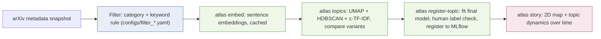

# imaging-ai-atlas

How has AI research in medical imaging shifted over the last decade? A topic-modeling pipeline over
arXiv metadata, told as a data story — findings, limitations, and figures land as the pipeline stages
below are completed.

The research topic itself is a config, not a hardcoded assumption: the filter rule that decides which
papers count can point at medical imaging AI (the current default) or a narrower domain, with no code
change. See [Changing the research topic](#changing-the-research-topic).

## Pipeline



| Stage | Command | What it does |
|---|---|---|
| Filter | config, applied by every command below | category scope + keyword rule over title/abstract, defined in a YAML file (`configs/filter_medical_imaging.yaml` by default) — see ADR 0003, 0005 |
| Data quality | `imaging_ai_atlas.data.quality` (library) | dedup, short/missing abstracts, LaTeX leakage, date-field anomalies — see `reports/data_quality.md` |
| Embeddings | `atlas embed` | sentence-transformers, cached by model + revision + data hash, Matryoshka-dimension ablation — ADR 0004 |
| Topic model comparison | `atlas topics` | UMAP (5D) → HDBSCAN → CountVectorizer → c-TF-IDF, compared across embedding variants (diversity, NPMI, outlier rate, seed stability) |
| Topic model registration | `atlas register-topic` | fits the chosen primary model once, registers it as a standard MLflow artifact, writes a human coherence-check sample for the largest topics |
| Story | `atlas story` | 2D topic map + topic-share-over-time charts, written to `reports/figures/` |

Exploratory analysis of each stage's output lives in `notebooks/01_eda.ipynb`.

## Running the pipeline

Each command reads the previous stage's output and writes its own under `data/interim/`
or `reports/`, so they run in order:

```bash
atlas embed           # cache sentence embeddings for every configured model/dims
atlas topics          # compare topic models across embedding variants
atlas register-topic  # fit + register the chosen primary topic model
atlas story           # build the 2D topic map and topic-dynamics charts
```

All four accept `--filter-config-path` to point at a different research-topic domain (see
below). `atlas --help` and `atlas <command> --help` list every option and default.

## Changing the research topic

The filter rule — which papers count as "in scope" — is a config, not code (ADR 0005). To point this
pipeline at a different topic (e.g. a narrower clinical-imaging subtopic instead of medical imaging AI
broadly):

1. Write a new `configs/filter_<topic>.yaml` with a `category_scope` (arXiv categories) and
   `keyword_patterns` (regex, OR'd together).
2. Pass `--filter-config-path configs/filter_<topic>.yaml` to every `atlas` command.
3. Measure precision/recall on a hand-labeled sample before trusting the new rule — same method as
   ADR 0003, since a plausible-looking keyword list is not a validated one.

## Prerequisites

- Python 3.12, managed via [uv](https://docs.astral.sh/uv/).
- `uv sync --extra dev` to install the project and dev tooling into `.venv`.
- `uv run lefthook install` to install the git hooks (pre-commit, commit-msg, pre-push).
- [gitleaks](https://github.com/gitleaks/gitleaks) on `PATH` (used by the pre-commit hook; not a Python
  dependency).
- A CUDA-capable GPU is optional. `torch` resolves to a CUDA 12.6 wheel on Windows and a CPU wheel on
  Linux CI — see `[tool.uv.sources]` in `pyproject.toml`.

## Repository conventions

- No raw data is committed. `data/` is git-ignored; datasets are versioned with DVC and documented in each
  stage's ADR.
- Decisions with lasting consequences are recorded as ADRs under `docs/decisions/`.

## License

MIT — see [LICENSE](LICENSE). Derived data is CC0.
