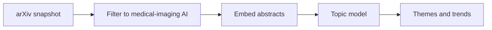

# imaging-ai-atlas

[](https://github.com/danielasicaru/imaging-ai-atlas/actions/workflows/ci.yml)
[](https://github.com/danielasicaru/imaging-ai-atlas/actions/workflows/security.yml)

[](LICENSE)

**How has AI research in medical imaging changed over the last decade?** This project
filters all 3,233,527 arXiv papers down to the 30,872 about AI for medical imaging,
groups them into research themes with a topic model, and measures which themes are
growing or shrinking, with confidence intervals rather than eyeballed trends.

| At a glance | |
|---|---|
| **Data** | 3,233,527 arXiv papers filtered to 30,872 on medical-imaging AI |
| **Filter quality** | precision 0.895 (95% CI 0.845-0.930) on a 300-paper hand-labelled sample |
| **Model choice** | 3 embedding models, 7 variants, compared on diversity, coherence, outlier rate and 5-seed stability |
| **Themes** | 30 largest themes reviewed by hand; all 30 judged coherent |
| **Trends** | rising/fading ranking with 1,000-resample bootstrap confidence intervals |
| **Stack** | Python, sentence-transformers, BERTopic (UMAP + HDBSCAN), MLflow, pandas, matplotlib |


## What the data shows

**Output has grown almost every year since 2017.** Medical-imaging AI went from a few
hundred papers a year on arXiv to thousands. Read the 2017-2019 jump with care: part
of it is the `eess.IV` category only coming into real use then, not just new research.


**It is a small, well-defined slice of arXiv.** A category-plus-keyword filter keeps
30,872 of 3,233,527 papers (~1.0%), with a measured precision of 0.895 (95% CI
0.845-0.930) on a hand-labelled sample. Recall is *not* known to be good; see the
limitations in the report.


**Segmentation architectures are still rising; radiation physics is fading.** Ranking
the 30 human-reviewed themes by the slope of their yearly share, the clearest riser is
transformer and U-Net segmentation (95% CI entirely above zero), followed by COVID-19
chest X-ray/CT and radiology report generation. The clearest decliners are radiation
detectors and therapy physics, and fMRI functional connectivity.


**Brain tumor MRI and retinal imaging are the two largest themes**, followed by
segmentation architectures, a method rather than an organ.


**Computer vision has become the home category.** The share of papers filed under
`cs.CV` has kept rising, while `eess.IV` (image and video processing) peaked around
2020 and has fallen steadily since, and `cs.AI` has grown.


The full write-up (data quality, why this embedding and topic model, all 30 themes, the
trend estimates, and a limitations and ethics section) is in
[`reports/report.md`](reports/report.md). A second, narrower study on cervical-spine
fracture AI that combines arXiv with PubMed, including a comparison of preprints and
journal papers, is in [`reports/report_cervical_spine.md`](reports/report_cervical_spine.md).

## What this project demonstrates

- **Model selection with evidence, not defaults.** Embedding models were compared on
  several metrics and across seeds, and a linear PCA control showed the non-linear
  UMAP step is doing real work (189 topics vs. 3). The reasoning is in
  [ADR 0004](docs/decisions/0004-embedding-and-topic-model-choice.md).
- **Validation by people, not just metrics.** Filter precision was measured on a
  hand-labelled sample, and every one of the 30 largest themes was read and judged
  for coherence before it appears in a finding.
- **Honest uncertainty.** Trends come with bootstrap confidence intervals, and the
  report says plainly what is not known, such as the filter's recall.
- **Reproducibility.** Locked dependencies, model weights pinned to a specific
  revision, fixed seeds, raw data pinned by checksum, and every registered model
  logged to MLflow with its data hash, model and git commit.
- **Software engineering.** A typed, tested package with a CLI. CI runs linting, type
  checks, tests and secret scanning on every push, a dependency vulnerability scan
  whenever dependencies change (and weekly), and a security audit of the workflows
  themselves. Design decisions are recorded as [ADRs](https://github.com/danielasicaru/imaging-ai-atlas/tree/main/docs/decisions).
- **Reusable by design.** The research topic is a config file. A second study on
  cervical-spine fracture AI reuses the same pipeline with an added PubMed source and
  no changes to the modelling code.

## How it works



```bash
uv sync --extra dev   # install (Python 3.12, uv)
# then ingest the arXiv snapshot: see docs/pipeline.md
atlas embed           # embed the filtered abstracts
atlas topics          # compare topic models
atlas register-topic  # fit and register the chosen model
atlas story           # build all six figures
```

The research topic is a config file, not code: point the same pipeline at a different
domain with `--filter-config-path`. Every stage, command and option, plus how to change
the topic, is in [`docs/pipeline.md`](docs/pipeline.md). Every figure above is built by
`atlas story`; [`notebooks/01_eda.ipynb`](https://github.com/danielasicaru/imaging-ai-atlas/blob/main/notebooks/01_eda.ipynb) walks through the same
corpus step by step.

## Related work

[ArXiv Atlas](https://github.com/Jaluus/ArXivAtlas) maps arXiv papers for exploring and
finding them; this project instead tracks how one field's themes change over time. See
section 8 of the [report](reports/report.md).

## Limitations

- **Filter recall is unknown.** No misses were found in a 100-paper sample of rejected
  papers, but that sample is far too small to rule out missing a few percent of 3.2
  million papers.
- **Volume is not impact.** A rising theme means more arXiv papers mention it, not
  that it works better or is used in clinics.
- **Only the 30 largest themes were reviewed**, so the trend ranking says nothing about
  the ~160 smaller ones.

## Repository conventions

- No raw data is committed. `data/` is git-ignored; each raw snapshot is pinned by its
  SHA-256 in `data/raw/SHA256SUMS` (verify with `cd data/raw && sha256sum -c SHA256SUMS`)
  and documented in its stage's ADR (see ADR 0007).
- Decisions with lasting consequences are recorded as ADRs under `docs/decisions/`.

## License

MIT, see [LICENSE](LICENSE). Derived data is CC0.
