# Pipeline reference

How the pipeline is put together and how to run or retarget it. The findings are in the
[README](../README.md) and the full write-up in [`reports/report.md`](../reports/report.md).

## Stages

```mermaid
flowchart LR
    classDef data fill:#e8eef7,stroke:#4a6fa5
    classDef model fill:#eef7e8,stroke:#5a9a4a
    classDef story fill:#f7e8ee,stroke:#a5457a

    arxiv[arXiv metadata snapshot]
    pubmed[PubMed XML, fetched via NCBI E-utilities]
    arxiv --> ing1["atlas ingest arxiv"]:::data
    pubmed --> ing2["atlas ingest pubmed"]:::data
    ing1 --> comb["atlas combine-corpora (optional, for multi-source corpora)"]:::data
    ing2 --> comb
    comb --> filt["Filter: category + keyword rule (configs/filter_*.yaml)"]:::data
    filt --> emb["atlas embed: sentence embeddings, cached"]:::model
    emb --> top["atlas topics: UMAP + HDBSCAN + c-TF-IDF, compare variants"]:::model
    top --> reg["atlas register-topic: fit final model, human label check, register to MLflow"]:::model
    reg --> sty["atlas story: 2D map, topic dynamics and corpus charts"]:::story
```



| Stage | Command | What it does |
|---|---|---|
| Fetch (PubMed only) | `atlas fetch-pubmed` | queries NCBI E-utilities (esearch + efetch) for a search string, saves raw XML — not needed for arXiv, which is ingested from a pre-downloaded snapshot |
| Ingest | `atlas ingest <arxiv\|pubmed>` | parses a raw snapshot/XML into the normalized `PaperRecord` parquet schema every later stage reads — see ADR 0001, 0006 |
| Combine (optional) | `atlas combine-corpora` | merges multiple sources' ingested parquet files into one corpus, deduping on `(source, external_id)` — only needed for a multi-source corpus |
| Filter | config, applied by every command below | category scope + keyword rule over title/abstract, defined in a YAML file (`configs/filter_medical_imaging.yaml` by default) — see ADR 0003, 0005, 0006 |
| Data quality | `imaging_ai_atlas.data.quality` (library) | dedup, short/missing abstracts, LaTeX leakage, date-field anomalies — see `reports/data_quality.md` |
| Embeddings | `atlas embed` | sentence-transformers, cached by model + revision + data hash, Matryoshka-dimension ablation — ADR 0004 |
| Topic model comparison | `atlas topics` | UMAP (5D) → HDBSCAN → CountVectorizer → c-TF-IDF, compared across embedding variants (diversity, NPMI, outlier rate, seed stability) |
| Topic model registration | `atlas register-topic` | fits the chosen primary model once, registers it as a standard MLflow artifact, writes a human coherence-check sample for the largest topics |
| Story | `atlas story` | 2D topic map, topic-share-over-time chart, and the four corpus charts (papers per year, filter funnel, category share, largest themes), written to `reports/figures/`; for a corpus combining sources, also a theme-mix-by-source CSV (`--source-mix-path`) |

`ingest`, `fetch-pubmed`, and `combine-corpora` all default their output path to
`data/interim/papers.parquet` — the same default `embed`/`topics`/`register-topic`/`story`
read from — so running any of them for a second corpus needs an explicit `--out-path`
(or `--raw-path` for `fetch-pubmed`) to avoid overwriting the main corpus's file. Each
refuses to silently overwrite an existing output; pass `--force` if you mean it.

## Running the pipeline

Each command requires the previous one's output and checks for it on startup (clear error
if missing), so they must run in this order:

```bash
# arXiv metadata snapshot (Kaggle mirror, see ADR 0001), checked against data/raw/SHA256SUMS
atlas ingest arxiv --raw-path data/raw/arxiv-metadata-oai-snapshot.json
atlas embed           # cache sentence embeddings for every configured model/dims
atlas topics          # compare topic models across embedding variants
atlas register-topic  # fit + register the chosen primary topic model
atlas story           # build the 2D topic map, topic dynamics and corpus charts
```

The last four accept `--filter-config-path` to point at a different research-topic domain (see
below). `atlas --help` and `atlas <command> --help` list every option and default.

## Changing the research topic

The filter rule — which papers count as "in scope" — is a config, not code (ADR 0005). To point this
pipeline at a different topic (e.g. a narrower clinical-imaging subtopic instead of medical imaging AI
broadly):

1. Write a new `configs/filter_<topic>.yaml` with a `category_scope` (arXiv categories, or PubMed MeSH
   headings if combining in a second source) and `keyword_patterns` (regex, OR'd together).
2. If the topic needs a second source, fetch + ingest it (e.g. `atlas fetch-pubmed "<query>" <email>`
   then `atlas ingest pubmed`) and combine it with the arXiv corpus via `atlas combine-corpora`.
3. Pass `--filter-config-path configs/filter_<topic>.yaml` (and `--papers-path` if using a combined
   corpus) to every `atlas` command.
4. Measure precision/recall on a hand-labeled sample before trusting the new rule — same method as
   ADR 0003, since a plausible-looking keyword list is not a validated one. `category_scope` and
   `keyword_patterns` are each OR'd internally, then AND'd together — a category list that mixes
   anatomy/domain terms with AI-task terms can let a non-AI paper clear the category gate on the
   anatomy term alone, with nothing enforcing the AI-relatedness the category list was meant to check
   (see ADR 0006 for a real instance of this).
5. A much smaller filtered corpus than the main one won't work with the default topic-model
   hyperparameters — `register-topic` has `--min-cluster-size`/`--min-df`/`--umap-n-neighbors`
   overrides for exactly this case.

`reports/report_cervical_spine.md` is a worked example of all of the above: a second, narrower topic
(cervical spine fracture detection/classification/segmentation) combining arXiv and PubMed.

## Prerequisites

- Python 3.12, managed via [uv](https://docs.astral.sh/uv/).
- `uv sync --extra dev` to install the project and dev tooling into `.venv`.
- `uv run lefthook install` to install the git hooks (pre-commit, commit-msg, pre-push).
- [gitleaks](https://github.com/gitleaks/gitleaks) on `PATH` (used by the pre-commit hook; not a Python
  dependency).
- A CUDA-capable GPU is optional. `torch` resolves to a CUDA 12.6 wheel on Windows and a CPU wheel on
  Linux CI — see `[tool.uv.sources]` in `pyproject.toml`.

